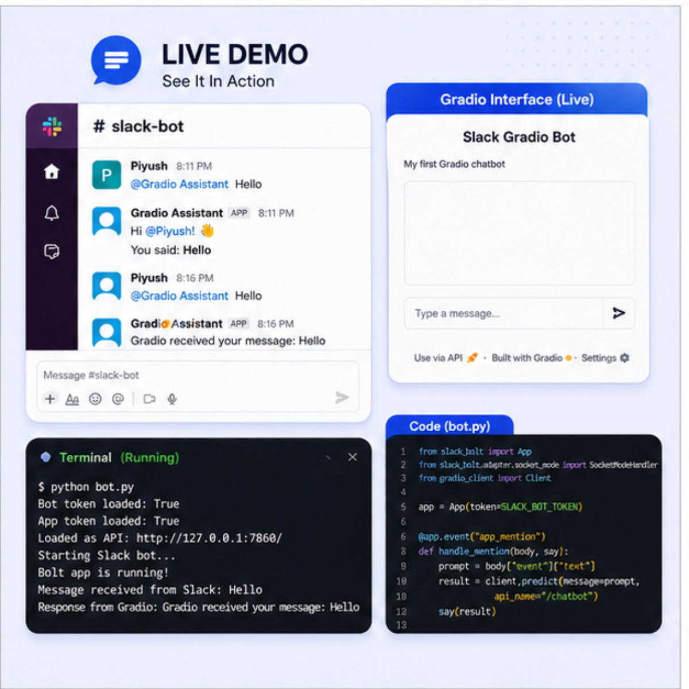

# Slack Bot Using Gradio

A Python project that connects Slack with a Gradio application. The bot receives Slack events through **Slack Socket Mode**, forwards message text to a Gradio endpoint, and posts the result back to Slack.

> **Demo preview:** The image below illustrates the Slack-to-Gradio workflow and terminal output. Replace it with a fresh screenshot from your own running app if you want to show an exact, unedited capture of the current implementation.



## Features

- **Real-time Slack events:** Uses Slack Bolt for Python with Socket Mode.
- **Mention handling:** Responds to supported bot mentions in Slack.
- **Gradio integration:** Sends message text to a Gradio app through `gradio_client.Client`.
- **Python backend:** Handles incoming events and sends replies to Slack.
- **Environment-based configuration:** Loads credentials from a local `.env` file.

## Architecture

```text
Slack message / @mention
          |
          v
Slack Socket Mode
          |
          v
Python bot (bot.py)
          |
          v
Gradio Client / Gradio endpoint
          |
          v
Response posted back to Slack
```

## Tech Stack

- Python
- Slack Bolt for Python
- Slack Socket Mode
- Gradio
- Gradio Client
- python-dotenv

## Project Structure

```text
slack-bot-using-gradio/
├── bot.py
├── gradio_app.py
├── .env.example
├── .gitignore
├── requirements.txt
├── README.md
└── assets/
    └── demo-preview.png
```

Adjust this tree if your actual repository contains different files or folders.

## Prerequisites

- Python installed
- A Slack workspace where you can install a Slack app
- A Slack bot token and an app-level token with Socket Mode enabled
- Access to the Gradio app/endpoint configured in `bot.py`

## Setup

### 1. Clone the repository

```bash
git clone https://github.com/YOUR_USERNAME/slack-bot-using-gradio.git
cd slack-bot-using-gradio
```

Replace `YOUR_USERNAME` with your GitHub username and use your actual repository URL/name.

### 2. Create and activate a virtual environment

Windows (Git Bash):

```bash
python -m venv .venv
source .venv/Scripts/activate
```

Windows (PowerShell):

```powershell
python -m venv .venv
.venv\Scripts\Activate.ps1
```

### 3. Install dependencies

If the repository has a `requirements.txt` file:

```bash
pip install -r requirements.txt
```

Otherwise, install the core packages:

```bash
pip install slack-bolt gradio gradio-client python-dotenv
```

### 4. Configure environment variables

Create a local file named `.env` in the project root:

```env
SLACK_BOT_TOKEN=your-slack-bot-token
SLACK_APP_TOKEN=your-slack-app-level-token
```

Use the exact variable names expected by your code. Keep real tokens only in your local `.env`; never commit that file.

### 5. Configure your Slack app

In the Slack API dashboard:

1. Create or open your Slack app.
2. Enable Socket Mode and create an app-level token with the required permission.
3. Add the bot token scopes and event subscriptions needed by your code.
4. Install the app in your workspace and invite it to the channel where you want to test it.
5. Put the tokens in your local `.env` file.

The required scopes and event subscriptions depend on the event handlers implemented in `bot.py`.

### 6. Run the project

If `gradio_app.py` starts the Gradio server locally, open one terminal and run:

```bash
python gradio_app.py
```

Then open a second terminal, activate the same virtual environment, and run:

```bash
python bot.py
```

If `bot.py` points to a hosted Gradio app instead, make sure its configured endpoint is accessible and follow the endpoint setup in your code.

## Security

- `.env` should be listed in `.gitignore`.
- Commit `.env.example` with placeholder values only.
- Never paste tokens into source code, README files, screenshots, or GitHub commits.
- If a token has been committed or exposed, revoke/rotate it.

## What I Learned

- Connecting a Slack app to Python using Slack Bolt.
- Receiving events with Socket Mode.
- Passing input to a Gradio application through the Gradio Client.
- Managing local configuration with environment variables.
- Debugging and testing an event-driven integration.

## Author

**Piyush**

- GitHub: [YOUR_USERNAME](https://github.com/YOUR_USERNAME)

---

If you use or extend this project, feel free to open an issue or submit a pull request.
